# MiBici

<a target="_blank" href="https://cookiecutter-data-science.drivendata.org/">
    
</a>

Dar respuesta a preguntas de negocio con técnicas de Machine Learning y DevOps sobre la operación de MiBici, el sistema de bicicleta pública del Área Metropolitana de Guadalajara. Para esto, se considera data histórica y de clustering para responder lo siguiente:

- P1: ¿Cuántos viajes se iniciarán en una estación o zona en un periodo futuro?.
- P2: ¿Una estación estará en riesgo de quedarse sin bicicletas o sin anclajes disponibles en un periodo futuro?
- P3: ¿Qué grupos de estaciones comparten patrones de uso y dónde se ubican en la ciudad?

## Organización del Proyecto
```
├── LICENSE            <- Open-source license if one is chosen
├── Makefile           <- Makefile with convenience commands like `make data` or `make train`
├── README.md          <- The top-level README for developers using this project.
├── data
│   ├── external       <- Data from third party sources.
│   ├── interim        <- Intermediate data that has been transformed.
│   ├── processed      <- The final, canonical data sets for modeling.
│   └── raw            <- The original, immutable data dump.
│
├── docs               <- A default mkdocs project; see www.mkdocs.org for details
│
├── models             <- Trained and serialized models, model predictions, or model summaries
│
├── notebooks          <- Jupyter notebooks. Naming convention is a number (for ordering),
│                         the creator's initials, and a short `-` delimited description, e.g.
│                         `1.0-jqp-initial-data-exploration`.
│
├── pyproject.toml     <- Project configuration file with package metadata for
│                         mibici and configuration for tools like black
│
├── references         <- Data dictionaries, manuals, and all other explanatory materials.
│
├── reports            <- Generated analysis as HTML, PDF, LaTeX, etc.
│   └── figures        <- Generated graphics and figures to be used in reporting
│
├── requirements.txt   <- The requirements file for reproducing the analysis environment, e.g.
│                         generated with `pip freeze > requirements.txt`
│
├── setup.cfg          <- Configuration file for flake8
│
└── mibici   <- Source code for use in this project.
    │
    ├── __init__.py             <- Makes mibici a Python module
    │
    ├── config.py               <- Store useful variables and configuration
    │
    ├── dataset.py              <- Scripts to download or generate data
    │
    ├── features.py             <- Code to create features for modeling
    │
    ├── modeling
    │   ├── __init__.py
    │   ├── predict.py          <- Code to run model inference with trained models
    │   └── train.py            <- Code to train models
    │
    └── plots.py                <- Code to create visualizations
```

---

### Setup inicial (Python 3.14)

El proyecto requiere **Python 3.14** (`pyproject.toml`). `requirements.txt` y `python_env.yaml`
fijan exactamente las mismas versiones.

```bash
python -m venv .venv
source .venv/bin/activate            # Windows: .venv\Scripts\activate
python -m pip install -r requirements.txt
```

---

### Servidor de tracking y variable `MLFLOW_TRACKING_URI`

El Model Registry requiere un backend con base de datos. En una terminal aparte (deja el
servidor corriendo):

```bash
mlflow server --backend-store-uri sqlite:///mlflow.db --port 5000
```

En la terminal de trabajo apunta MLflow al servidor:

```bash
export MLFLOW_TRACKING_URI=http://127.0.0.1:5000          # macOS / Linux
$env:MLFLOW_TRACKING_URI = "http://127.0.0.1:5000"        # Windows PowerShell
```

También puede ir en `.env` (`MLFLOW_TRACKING_URI="http://127.0.0.1:5000"`); `config.py` acepta
el nombre anterior `MLFLOW_URI` por compatibilidad. `mlflow.db` y `mlartifacts/` están en
`.gitignore`.

---

### Reproducir desde un clon limpio con `mlflow run`

1. Descarga los 12 CSV mensuales (`datos_abiertos_2025_10.csv` … `datos_abiertos_2026_09.csv`) y
   `nomenclatura_2026_09.csv` de https://mibici.net/es/datos-abiertos/ en `data/raw/`
   (los nombres están en `mibici/config.py`).
2. Con el servidor levantado y `MLFLOW_TRACKING_URI` exportada:

```bash
# Ingesta: limpia y une los datos, guarda el Parquet y escribe data/manifest.json
mlflow run . -e ingest --env-manager uv --experiment-name mibici-equipo41

# Entrenamiento por pregunta (o question=all para las tres)
mlflow run . -e train --env-manager uv --experiment-name mibici-equipo41 -P question=p1
mlflow run . -e train --env-manager uv --experiment-name mibici-equipo41 -P question=p2
mlflow run . -e train --env-manager uv --experiment-name mibici-equipo41 -P question=p3

# Con hiperparámetros (los defaults están en config.TRAIN_DEFAULTS)
mlflow run . -e train --env-manager uv --experiment-name mibici-equipo41 \
    -P question=p3 -P params="min_k=3,max_k=6"
```

- `--env-manager uv` crea el entorno de `python_env.yaml` (instala Python 3.14 si hace falta;
  requiere [uv](https://docs.astral.sh/uv/)). Si ya activaste `.venv` con `requirements.txt`,
  usa `--env-manager local` para reutilizarlo.
- Siempre pasa `--experiment-name mibici-equipo41`: el despachador rechaza corridas en otro
  experimento.
- Sin MLflow Project también funciona: `python -m mibici.dataset` y
  `python -m mibici.modeling.train --question p1`.

| Punto de entrada | Parámetros (`-P`)                                                                    | Qué hace                                                               |
| ---------------- | ------------------------------------------------------------------------------------ | ---------------------------------------------------------------------- |
| `ingest`         | —                                                                                    | `mibici/dataset.py`: Parquet en `data/interim/` y `data/manifest.json` |
| `train`          | `question` (p1, p2, p3, all), `model`, `params` (`"clave=valor,…"`), `stage_of_work` | `mibici/modeling/train.py` llama a `train_pX_model(...)`               |

### Versión de datos: `data/manifest.json`

La ingesta escribe, por archivo crudo, nombre, tamaño, codificación, número de filas, rango de
fechas (`date_min`, `date_max`) y SHA-256, además del hash del Parquet intermedio. `data_version`
(p. ej. `v1.0-b21c9761944d`) es un hash de los archivos crudos, del rango de fechas y de
`DATA_PIPELINE_VERSION`: si cambian los datos, cambia la versión. El manifiesto es el único
archivo de `data/` que se versiona en Git y se registra como artefacto en cada corrida.

### Trazabilidad común en MLflow (`mibici/modeling/tracking.py`)

| Función                                                  | Qué registra                                                                                         |
| -------------------------------------------------------- | ---------------------------------------------------------------------------------------------------- |
| `set_common_tags(question, model_family, stage_of_work)` | Etiquetas `team`, `git_commit`, `git_dirty`, `question`, `model_family`, `stage_of_work`             |
| `log_data_version(dataset=...)`                          | `data/manifest.json`, etiqueta `data_version` y el dataset con `mlflow.log_input`                    |
| `log_run_config(dict)`                                   | `config/run_config.json` y copia de `MLproject`, `python_env.yaml`, `requirements.txt` y `config.py` |

El despachador (`mibici/modeling/train.py`) crea una corrida `dispatch-…`, llama a
`train_pX_model(original_data, data_version, date_range, model=None, params=None)` y aplica estas
tres funciones a las corridas que la pregunta haya creado (quedan como corridas hijas). Cada
integrante puede llamarlas también dentro de sus propias corridas, por ejemplo para fijar
`stage_of_work="baseline"`.

Revisa los resultados en http://127.0.0.1:5000 (experimento `mibici-equipo41`).

---

### Como cargar el dataset inicial para uso en notebooks

1. Descarga los datos de nomenclatura y viajes mensuales https://mibici.net/es/datos-abiertos/
2. Revisa las declaraciones de `config.py`, modifica a partir de los datos que necesites

```

DATA_METADATA = {
    'monthly': YEARLY_DATA,
    'stations': STATIONS_DATA,
    'data_range': {'from': '2025_09', 'to': '2026_09'}
}
```

3. Ejecuta `dataset.py` para que se generen los datos procesados en `/data/interim`, observa los ejemplos propuestos en `dataset.py` y ajusta de ser necesario.

## Pruebas, validación de datos y seguridad

Todo se ejecuta desde la raíz del repositorio con el entorno del proyecto activado (Python 3.14,
`pip install -r requirements.txt`). Las pruebas no usan los datos reales ni el servidor de
MLflow: trabajan con datos sintéticos y un tracking temporal (`tests/conftest.py`).

| Comando               | Qué hace                                                                         | Requiere                                       |
| --------------------- | -------------------------------------------------------------------------------- | ---------------------------------------------- |
| `make test`           | PyTest: pruebas unitarias, reproducibilidad del entrenamiento e higiene del repo | Entorno del proyecto                           |
| `make security`       | bandit (código), pip-audit (dependencias) y detect-secrets (credenciales)        | Entorno del proyecto + internet (pip-audit)    |
| `make validation-env` | Crea el entorno de validación (Python 3.12) en `~/.venvs/mibici-validation`      | [uv](https://docs.astral.sh/uv/), una sola vez |
| `make validate`       | DeepChecks sobre los datos de P1, P2 y P3; reportes en `reports/validation/`     | Datos en `data/raw/` + entorno de validación   |
| `make check`          | Los tres anteriores en orden                                                     | Todo lo anterior                               |

Sin `make`: `python -m pytest`; los comandos de seguridad y validación están en el `Makefile`.

### Pruebas (PyTest)

```
tests/
├── conftest.py                      # datos sintéticos y MLflow temporal
├── mibici/test_dataset.py           # ingesta, manifiesto, hash y data_version
├── mibici/test_features.py          # limpieza y variables comunes
├── modeling/test_reproducibility.py # reproducibilidad de P1, P2 y P3
└── test_repo_hygiene.py             # seguridad del repositorio como pruebas
```

- **Unitarias**: casos normales y límite de la ingesta (`clean_trips`, `join_station_metadata`,
  `build_manifest`, `compute_data_version`…) y de `features.py` (fechas inválidas, duraciones
  negativas, duplicados y nulos).
- **Reproducibilidad**: cada pregunta entrena dos veces con la misma semilla y exige
  resultados idénticos — predicciones de Ridge, Random Forest y HistGradientBoosting (P1),
  probabilidades y métricas de la regresión logística (P2), etiquetas y silhouette de K-Means
  (P3). Dos pruebas de control cambian la semilla y verifican que la diferencia sí se detecta.
- **Higiene del repositorio**: rutas sensibles cubiertas por `.gitignore`, ningún archivo de
  datos, MLflow, modelos o credenciales versionado hoy **ni en el historial**, `.env.example`
  sin secretos y detect-secrets sin hallazgos nuevos.

### Validación de datos (DeepChecks)

`mibici/validation/validate_p3_data.py` ejecuta la suite de integridad de DeepChecks (tipos
mezclados, nulos, duplicados, valores únicos, caracteres especiales, etiquetas en conflicto,
correlaciones) sobre la tabla de P1, la tabla estación-hora de P2 y las características de
estaciones de P3.

DeepChecks 0.19.1, su última versión, no es compatible con el stack del proyecto: importa
`pkg_resources` (ya no incluido en setuptools ≥ 81), usa `np.Inf` (eliminado en numpy 2) y pide
el scorer `max_error` (eliminado en scikit-learn 1.9). Por eso corre en un **entorno aparte**
con Python 3.12 y versiones fijas en `requirements-validation.txt`. `make validate`:

1. En el entorno del proyecto, `python -m mibici.validation.prepare_inputs` deja listo el
   dataset común (`data/interim/`) y `data/processed/p3_station_features.csv`.
2. En el entorno de validación corre `validate_p3_data.py`, que lee esos archivos y escribe
   los reportes HTML.

```bash
make validation-env    # una sola vez
make validate
```

### Seguridad

| Chequeo                      | Herramienta                                                  | Resultado                                                                                                                                                                                                                                                                           |
| ---------------------------- | ------------------------------------------------------------ | ----------------------------------------------------------------------------------------------------------------------------------------------------------------------------------------------------------------------------------------------------------------------------------- |
| Código                       | `bandit -c pyproject.toml -r mibici`                         | Sin hallazgos. Los 11 avisos previos (llamadas a `git` con `subprocess` en tres copias de la misma función) se corrigieron: una sola función en `tracking.py`, con ruta absoluta a `git` y argumentos fijos; las 2 supresiones `# nosec` restantes están justificadas en el código. |
| Dependencias                 | `pip-audit -r requirements.txt`                              | Sin vulnerabilidades. Se encontró **CVE-2026-53995** (path traversal en FileStore) en mlflow 3.17.0 y se actualizó a 3.17.2.                                                                                                                                                        |
| Dependencias de validación   | `pip-audit` sobre `~/.venvs/mibici-validation`               | 3 avisos en setuptools 80.9.0 (construcción de sdist y wheels legacy en Windows). **Riesgo aceptado**: DeepChecks necesita `pkg_resources`, que no existe en las versiones corregidas, y el entorno de validación no construye ni instala paquetes de terceros.                     |
| Credenciales                 | `detect-secrets` con `.secrets.baseline`                     | Sin secretos. La línea base excluye por regla los falsos positivos: hashes SHA-256 del manifiesto, imágenes PNG embebidas en notebooks y reportes HTML de DeepChecks.                                                                                                               |
| Datos y variables de entorno | `.gitignore` + `.env.example` + `tests/test_repo_hygiene.py` | Datos de MiBici, `mlflow.db`, `mlartifacts/`, modelos y `.env` ignorados; ninguno aparece en el historial. Las variables locales van en `.env` (copiar desde `.env.example`).                                                                                                       |

### Evidencia

| Ejecución                  | Captura                                                             |
| -------------------------- | ------------------------------------------------------------------- |
| PyTest                     | 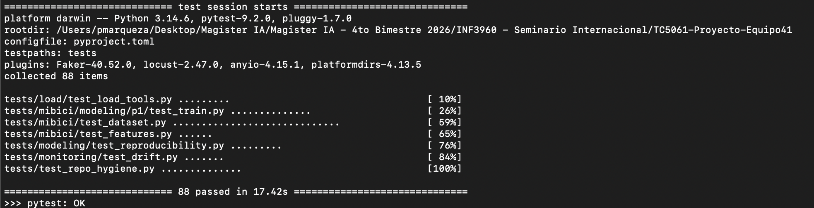                    |
| DeepChecks                 | 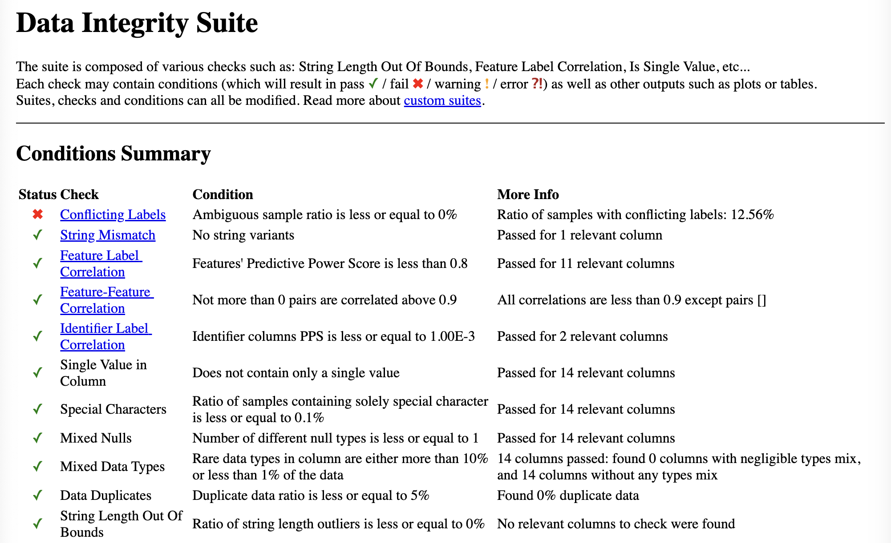            |
| bandit                     | 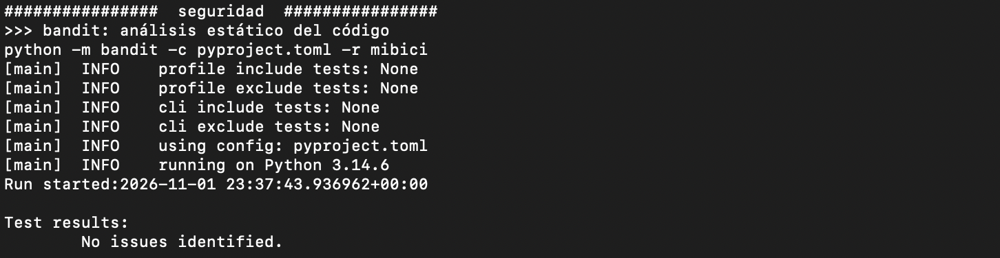                    |
| pip-audit y detect-secrets | 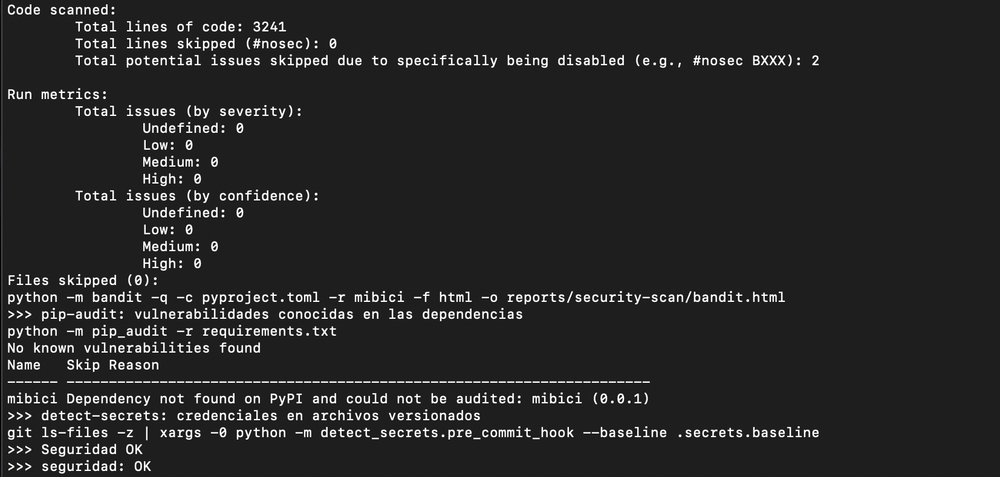               |
| Reproducibilidad           | 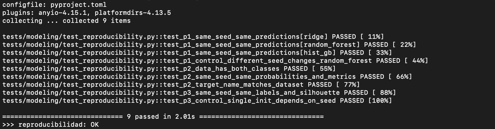 |

Reportes generados: `reports/security-scan/bandit.html` y `reports/validation/*.html`.

## Correr FastAPI con Docker

La API sirve los modelos de **P3** (grupos de estaciones) y **P1** (demanda de viajes por
estación y hora). Los modelos se toman del Model Registry de MLflow por nombre y alias, según las
variables de entorno de la tabla siguiente, y se cargan al arrancar la API.

**Precondición**: los modelos deben estar entrenados y registrados. Si no lo están:

```bash
mlflow run . -e train --env-manager local --experiment-name mibici-equipo41 -P question=p3
mlflow run . -e train --env-manager local --experiment-name mibici-equipo41 -P question=p1 -P model=random_forest -P ... (model params)
```

### Variables de entorno

La API las lee de `.env` (con `python-dotenv`) o del entorno del proceso. Cada modelo se define
con su nombre en el registry, su alias y la URI desde donde se carga.

| Variable              | Ejemplo                                         | Uso                                                |
| --------------------- | ----------------------------------------------- | -------------------------------------------------- |
| `MLFLOW_TRACKING_URI` | `http://127.0.0.1:5000`                         | Servidor de MLflow con el Model Registry           |
| `P3_MODEL_NAME`       | `mibici-equipo41-p3-grupos`                     | Modelo registrado de P3                            |
| `P3_MODEL_ALIAS`      | `champion`                                      | Alias de la versión de P3 que se sirve             |
| `P3_MODEL_URI`        | `models:/mibici-equipo41-p3-grupos@champion`    | URI desde donde se carga P3                        |
| `P1_CURRENT_MODEL`    | `mibici-equipo41-p1-demanda`                    | Modelo registrado de P1 (versión actual)           |
| `P1_CURRENT_ALIAS`    | `champion`                                      | Alias de la versión actual de P1                   |
| `P1_CURRENT_URI`      | `models:/mibici-equipo41-p1-demanda@champion`   | URI desde donde se carga la versión actual de P1   |
| `P1_CHALLENGER_MODEL` | `mibici-equipo41-p1-demanda`                    | Modelo registrado de P1 (versión retadora)         |
| `P1_CHALLENGER_ALIAS` | `challenger`                                    | Alias de la versión retadora de P1                 |
| `P1_CHALLENGER_URI`   | `models:/mibici-equipo41-p1-demanda@challenger` | URI desde donde se carga la versión retadora de P1 |

Para correr la API localmente, copia estas variables a `.env` (están en `.env.example`) y la
versión que reporta cada respuesta se consulta en el registry a partir del nombre y el alias, así
que la URI debe apuntar al mismo nombre y alias. En Docker no se usa `.env`: el `Dockerfile` define
las variables y apunta las URIs a los modelos exportados en la imagen, cuya versión se lee del
archivo `VERSION` de cada carpeta.

**Pasos** (desde la raíz del repositorio, con Docker Desktop abierto):

1. Levanta MLflow: `mlflow server --backend-store-uri sqlite:///mlflow.db --port 5000`
2. En otra terminal, descarga los modelos del registry a `models/p3_model/`, `models/p1_current/`
   y `models/p1_challenger/`:
   ```bash
   export MLFLOW_TRACKING_URI=http://127.0.0.1:5000
   python -m mibici.api.scripts.export_model
   ```
3. Construye la imagen: `docker build -t mibici-api .`
4. Levanta el contenedor: `docker run --rm --name mibici-api -p 8000:8000 mibici-api`
5. Prueba la API desde otra terminal (o en `http://localhost:8000/docs`):

| Endpoint                  | Qué devuelve                                                |
| ------------------------- | ----------------------------------------------------------- |
| `GET /health`             | Estado del servicio                                         |
| `POST /predict/p3`        | Grupo predicho para una estación                            |
| `POST /predict/p1/abtest` | Viajes predichos para una estación, hora y día de la semana |

### `POST /predict/p3`

**Entrada.** La petición trae el uso agregado de una estación, con el mismo esquema que
`data/processed/p3_station_features.csv`. La API calcula las variables del modelo
(proporciones por franja horaria y logaritmos de los viajes) con la misma función del
entrenamiento (`prepare_features`) y entrega al modelo solo las columnas de su firma, sea cual sea
el candidato que quedó como campeón.

```bash
curl -X POST http://localhost:8000/predict/p3 \
  -H "Content-Type: application/json" \
  -d '{"viajes_salida": 856, "viajes_llegada": 754, "salidas_manana": 235,
       "salidas_tarde": 229, "salidas_noche": 380, "salidas_madrugada": 12,
       "salidas_fin_semana": 179, "duracion_promedio": 13.4}'
```

```json
{ "grupo_predicho": 0, "modelo": "mibici-equipo41-p3-grupos", "version": "2" }
```

El número de grupo y la versión dependen del modelo registrado en cada equipo.

**Validación (Pydantic).** Todos los campos son obligatorios; los conteos son enteros ≥ 0; la
duración promedio, en minutos, es mayor que 0 y menor o igual que 1440; la suma de salidas por franja y las salidas de fin de
semana no pueden superar `viajes_salida`; no se aceptan campos extra. Una entrada inválida
responde `422` con el campo y el motivo, por ejemplo:

```json
{
  "detail": [
    {
      "type": "greater_than_equal",
      "loc": ["body", "viajes_salida"],
      "msg": "Input should be greater than or equal to 0",
      "input": -5,
      "ctx": { "ge": 0 }
    }
  ]
}
```

### `POST /predict/p1/abtest`

**Entrada.** Estación, hora y día de la semana para los que se quiere estimar el número de viajes
que inician, más los viajes reales observados.

| Campo       | Tipo   | Descripción                                        |
| ----------- | ------ | -------------------------------------------------- |
| `origen_id` | entero | Identificador de la estación de origen             |
| `hora`      | entero | Hora del día (0 a 23)                              |
| `dia`       | texto  | Día de la semana en inglés: `Monday` … `Sunday`    |
| `y`         | número | Viajes reales que iniciaron en esa estación y hora |

```bash
curl -X POST http://localhost:8000/predict/p1/abtest \
  -H "Content-Type: application/json" \
  -d '{"origen_id": 272, "hora": 8, "dia": "Monday", "y": 7}'
```

**Salida.** `prediction` es el número de viajes estimado (nunca negativo) y `model` el alias del
modelo de P1 que respondió.

```json
{ "prediction": 6.76, "model": "champion" }
```

Todos los campos son obligatorios; una entrada con tipos inválidos responde `422`.

### Estrategia de despliegue y reproducibilidad

Para los modelos P3 y P1 de MiBici se seleccionó una estrategia de **inferencia bajo demanda** mediante una API REST desarrollada con FastAPI. Para P3, el servicio recibe características agregadas de los viajes de una estación y devuelve su grupo estimado; para P1, recibe una estación, una hora y un día de la semana y devuelve los viajes estimados. En ningún caso se vuelve a entrenar el modelo en cada petición.

Esta modalidad facilita integrar el agrupamiento con aplicaciones externas mediante HTTP. La predicción se obtiene cuando un cliente consulta el servicio, pero esto **no significa que los datos de viajes se reciban en tiempo real**: las entradas corresponden a métricas agregadas previamente. Por ello, el servicio es adecuado para consultas puntuales; si se necesitara clasificar periódicamente un gran número de estaciones, podría incorporarse un proceso adicional de inferencia por lotes.

Se eligió **empaquetar una copia de los modelos en la imagen**, en lugar de conectarse al Model Registry durante cada arranque. Antes de construir el contenedor, `python -m mibici.api.scripts.export_model` recupera del registro MLflow tres modelos, cada uno con su firma y un archivo `VERSION`:

| Modelo registrado | Alias | Carpeta |
|---|---|---|
| `mibici-equipo41-p3-grupos` | `champion` | `models/p3_model/` |
| `mibici-equipo41-p1-demanda` | `champion` | `models/p1_current/` |
| `mibici-equipo41-p1-demanda` | `challenger` | `models/p1_challenger/` |

Esto evita que la API requiera un servidor MLflow disponible durante la inferencia.

El contenedor reúne la aplicación, los modelos exportados y las dependencias necesarias, lo que favorece la **portabilidad y la reproducibilidad del despliegue**. El archivo `VERSION` de cada carpeta permite identificar la versión utilizada. Si cambia el alias `champion` o `challenger`, se debe **volver a exportar los modelos y reconstruir la imagen** para publicar el cambio; el contenedor en ejecución no actualiza los modelos automáticamente.

### Ejecución y consumo desde Windows PowerShell

Esta alternativa complementa los comandos Bash anteriores. Desde la raíz del repositorio, con el entorno Python activado y **Docker Desktop iniciado**, usa las siguientes instrucciones. Se supone que los modelos P3 y P1 ya están entrenados y registrados en el MLflow local.

**1. Iniciar MLflow** (mantén abierta esta terminal):

```powershell
mlflow server --backend-store-uri sqlite:///mlflow.db --port 5000
```

**2. Exportar los modelos** (en una segunda terminal):

```powershell
$env:MLFLOW_TRACKING_URI = "http://127.0.0.1:5000"
python -m mibici.api.scripts.export_model
```

**3. Construir la imagen:**

```powershell
docker build -t mibici-api .
```

**4. Levantar el contenedor** (mantén abierta esta terminal):

```powershell
docker run --rm --name mibici-api -p 8000:8000 mibici-api
```

**5. Comprobar el servicio** (en otra terminal):

```powershell
Invoke-RestMethod -Uri "http://localhost:8000/health" -Method Get
```

**6. Consultar el grupo de una estación:**

```powershell
$body = @{
    viajes_salida = 856
    viajes_llegada = 754
    salidas_manana = 235
    salidas_tarde = 229
    salidas_noche = 380
    salidas_madrugada = 12
    salidas_fin_semana = 179
    duracion_promedio = 13.4
} | ConvertTo-Json

Invoke-RestMethod -Uri "http://localhost:8000/predict/p3" `
    -Method Post `
    -ContentType "application/json" `
    -Body $body
```

La petición utiliza los mismos valores de ejemplo del apartado anterior. La respuesta incluye `grupo_predicho`, `modelo` y `version`; el grupo y la versión dependen del modelo campeón empaquetado.

**7. Estimar los viajes de una estación:**

```powershell
$body = @{
    origen_id = 272
    hora = 8
    dia = "Monday"
    y = 7
} | ConvertTo-Json

Invoke-RestMethod -Uri "http://localhost:8000/predict/p1/abtest" `
    -Method Post `
    -ContentType "application/json" `
    -Body $body
```

La respuesta incluye `prediction` (viajes estimados) y `model` (alias del modelo de P1 que respondió). También está disponible la interfaz interactiva de FastAPI en <http://localhost:8000/docs> mientras el contenedor está activo.

### Evidencia del contenedor

> Las capturas corresponden a la versión anterior de la API (solo P3); hay que actualizarlas con la
> imagen que incluye P1.

| Paso                | Captura                                            |
| ------------------- | -------------------------------------------------- |
| `docker build`      | 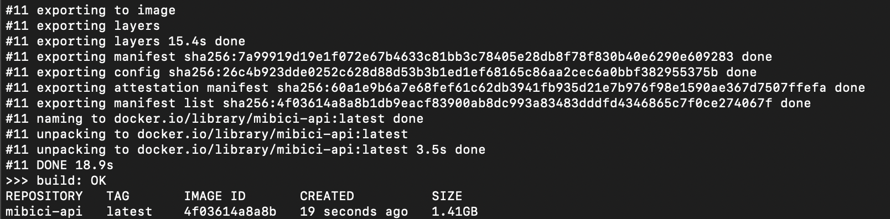 |
| `docker run`        | 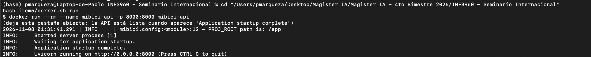     |
| Peticiones a la API | 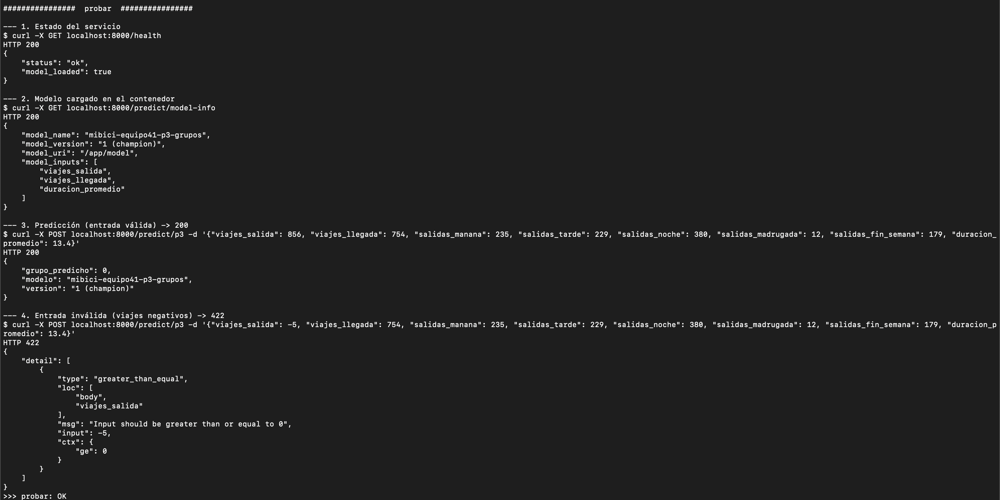          |

## Monitoreo de drift (Evidently)

El objetivo es detectar cuándo los datos de producción se alejan de los de entrenamiento. Se
monitorea el modelo **P3** que sirve la API (`mibici-equipo41-p3-grupos`, versión 1, alias
`champion`, candidato `KMeans_conteos_k2`).

### 1. Conjuntos de datos

| Conjunto           | Periodo                        | Viajes             | Por qué                                                                                                 |
| ------------------ | ------------------------------ | ------------------ | ------------------------------------------------------------------------------------------------------- |
| **Referencia**     | octubre 2025 – septiembre 2026 | 4.497.119          | Es exactamente el periodo con que se entrenó el campeón de P3 (`data_version` `v1.0-cec7eeaf7d56`)      |
| **Actual**         | octubre 2026                   | 635.532            | Primer mes publicado por MiBici **después** del entrenamiento: es lo que el modelo recibe en producción |
| Control estacional | octubre 2025 vs octubre 2026   | 420.064 vs 635.532 | Mismo mes un año antes, para separar temporada de cambio real                                           |

La API de P3 no registra las peticiones que recibe, así que la producción se representa con el mes
siguiente de los datos abiertos. Ambos conjuntos pasan por el mismo pipeline del proyecto
(`clean_trips`, `join_station_metadata` y `mibici/P3/features.py`) y se comparan en dos niveles:

- **Viajes** (lo que llega al sistema): hora, día de la semana, fin de semana, duración, estación de
  origen y de destino, viajes circulares y origen fuera del catálogo. Se usa una muestra aleatoria
  de 200.000 viajes por periodo, con semilla 42, sin datos personales (género ni año de nacimiento).
- **Estaciones** (la entrada del modelo P3): las variables de `p3_station_features.csv` con la
  transformación de la API (`prepare_features`) y el **grupo que predice el campeón**. Como el
  modelo se entrenó con totales de 12 meses, los conteos de octubre se llevan a escala anual
  (× 365/31).

### 2. Reportes

```bash
make drift                                     # referencia 2025_10:2026_09 vs actual 2026_10
make drift REFERENCE=2025_10:2025_10 CURRENT=2026_10:2026_10   # control estacional
```


Genera en `reports/drift/` dos reportes de Evidently 0.7 (`DataDriftPreset` y `DataSummaryPreset`)
y un resumen:

| Archivo                                                          | Contenido                                                                 |
| ---------------------------------------------------------------- | ------------------------------------------------------------------------- |
| [`trips_drift.html`](reports/drift/trips_drift.html)             | Drift por variable y calidad de los datos a nivel de viaje                |
| [`p3_stations_drift.html`](reports/drift/p3_stations_drift.html) | Drift por variable de la entrada del modelo P3 y de sus predicciones      |
| [`drift_summary.json`](reports/drift/drift_summary.json)         | Tabla por variable, cambio de grupo por estación e indicadores de calidad |

Evidently elige la prueba según el tamaño y el tipo de variable. Con más de 1.000 filas (viajes)
usa distancias: Wasserstein normalizada para numéricas y Jensen-Shannon para categóricas, con drift
si la distancia es ≥ 0,1. Con menos de 1.000 (estaciones) usa pruebas estadísticas: K-S para
numéricas y prueba Z de proporciones para el grupo, con drift si p < 0,05. El reporte es
reproducible: dos corridas dan exactamente los mismos valores.

**Viajes · 3 de 8 variables con drift**

| Variable             | Prueba         | Valor | Drift  | Control oct-25 vs oct-26 |
| -------------------- | -------------- | ----- | ------ | ------------------------ |
| `duracion_minutos`   | Wasserstein    | 0,217 | **Sí** | 0,246 · Sí               |
| `destino_id`         | Jensen-Shannon | 0,132 | **Sí** | 0,198 · Sí               |
| `origen_id`          | Jensen-Shannon | 0,131 | **Sí** | 0,200 · Sí               |
| `dia_semana`         | Jensen-Shannon | 0,041 | No     | 0,048 · No               |
| `hora`               | Wasserstein    | 0,021 | No     | 0,035 · No               |
| `viaje_circular`     | Jensen-Shannon | 0,013 | No     | 0,027 · No               |
| `origen_en_catalogo` | Jensen-Shannon | 0,013 | No     | 0,000 · No               |
| `fin_de_semana`      | Jensen-Shannon | 0,001 | No     | 0,033 · No               |

**Estaciones (entrada de P3) · 7 de 11 variables con drift**

| Variable                                             | p-valor K-S / Z | Drift           |
| ---------------------------------------------------- | --------------- | --------------- |
| `viajes_salida`, `viajes_llegada` (y sus logaritmos) | < 0,001         | **Sí**          |
| `duracion_promedio`                                  | < 0,001         | **Sí**          |
| `grupo_predicho`                                     | < 0,001         | **Sí**          |
| `salidas_noche_proporcion`                           | 0,035           | **Sí** (límite) |
| `salidas_manana_proporcion`                          | 0,053           | No (límite)     |
| `salidas_fin_semana_proporcion`                      | 0,149           | No              |
| `salidas_madrugada_proporcion`                       | 0,275           | No              |
| `salidas_tarde_proporcion`                           | 0,367           | No              |

**Calidad de los datos**: buena en ambos periodos y mejor en octubre. Las estaciones fuera del
catálogo pasan de 0,04 % a 0 %, los viajes de duración cero de 0,08 % a 0,03 %, y los de más de 3
horas se mantienen en 0,01 %. No hay valores nulos en las variables usadas, porque `clean_trips`
los descarta, y no aparecen fechas fuera del periodo.

### 3. Interpretación

**El sistema creció, pero se usa en los mismos horarios.**

| Indicador              | Referencia     | Octubre 2025   | Octubre 2026                                      |
| ---------------------- | -------------- | -------------- | ------------------------------------------------- |
| Viajes por día         | 12.321         | 13.551         | **20.501** (+66 % vs referencia, +51 % vs oct-25) |
| Estaciones con viajes  | 471            | 367            | 470 (+103 desde oct-25)                           |
| Duración mediana / p99 | 9,4 / 33,4 min | 9,7 / 31,7 min | **8,0 / 29,8 min**                                |

- **Hay drift significativo en cuánto se usa cada estación y cuánto duran los viajes.** El reparto
  de viajes entre estaciones (`origen_id`, `destino_id`) y la duración cambian, y el cambio es
  todavía mayor contra octubre 2025. Por eso no es un efecto de temporada: el sistema se expandió
  (103 estaciones nuevas en un año) y la demanda creció un 51 % en el mismo mes. Con una red más
  densa, los viajes son más cortos.
- **No cambia cuándo se usa.** Hora, día de la semana, fin de semana y viajes circulares no
  presentan drift en ninguna de las dos comparaciones, y las proporciones por franja horaria de
  cada estación se mantienen (solo la nocturna queda en el límite). El patrón de uso es estable.

**Implicaciones para el desempeño**

- **P3 (modelo en producción).** El campeón agrupa por volumen y duración, y el grupo 1 es el de
  alto uso (unos 27.600 viajes al año por estación, contra 5.800 del grupo 0). Con los datos de
  octubre, **100 de 468 estaciones (21 %) cambian de grupo** y el grupo de alto uso pasa de 80 a
  180 estaciones (de 17 % a 38 %). Esas estaciones no cambiaron su patrón horario: subieron con el
  crecimiento general. La segmentación pierde sentido de negocio, porque "alto uso" significa
  cosas distintas antes y después. Hay que reentrenar con datos recientes, y conviene comparar con
  el candidato basado en proporciones, que no depende de la escala.
- **P1 (viajes por estación y hora).** Entrenado con menor demanda, **subestimaría
  sistemáticamente** los viajes, sobre todo en las estaciones que ganaron participación. Las
  estaciones nuevas no tienen historia (arranque en frío). La forma horaria y semanal, que es lo
  que más aporta al modelo, sigue siendo válida.
- **P2 (riesgo de estación vacía o llena).** Más viajes por anclaje significa más eventos de
  riesgo, así que la proporción de la clase positiva y el umbral de decisión calibrados ya no
  corresponden. Los viajes más cortos aceleran la rotación de bicicletas.

**Decisión**: hay drift de datos y de predicciones en P3, y no se explica por la temporada.
Corresponde reentrenar con una ventana que incluya los meses recientes y comparar la nueva versión
con el campeón actual antes de cambiar el alias `champion`. En este caso no aplica el control
estacional para `grupo_predicho` (oct-25 vs oct-26): ahí ambos meses quedan en escala mensual y el
modelo, entrenado con totales anuales, asigna todas las estaciones al grupo de bajo uso.

### Evidencia

| Paso                                   | Captura                                                |
| -------------------------------------- | ------------------------------------------------------ |
| `make drift` en la Terminal            | 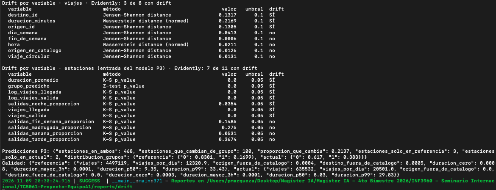 |
| Reporte de viajes (Evidently)          | 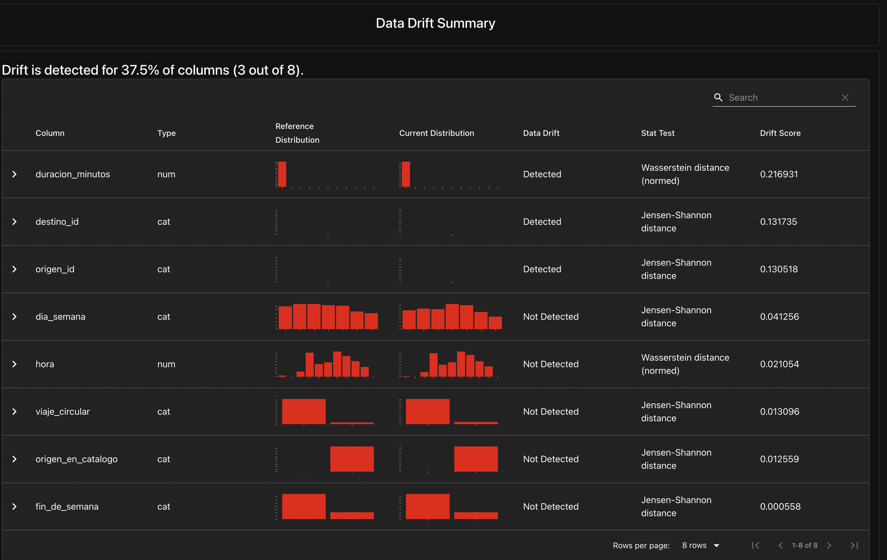      |
| Reporte de estaciones / P3 (Evidently) | 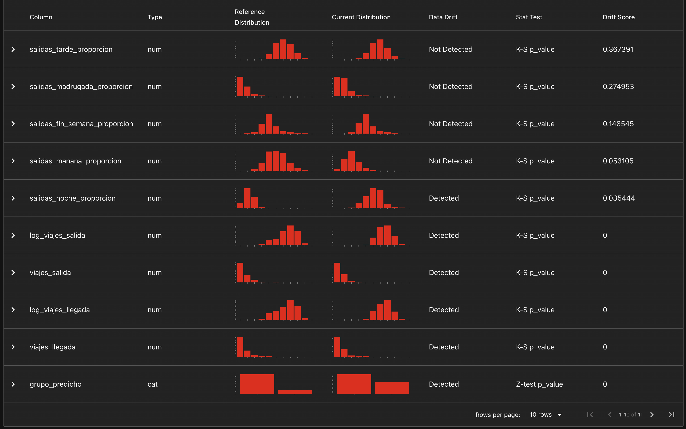             |

## Despliegue de servicios con Docker Compose

### Objetivo

Orquestar los servicios de la API de predicción de MiBici y el servidor MLflow mediante Docker Compose, permitiendo construir y ejecutar ambos servicios de manera conjunta y reproducible.

### Arquitectura de despliegue

La solución está compuesta por dos servicios:

| Servicio | Descripción | Puerto |
|---|---|---|
| `mlflow` | Servidor de seguimiento de experimentos y Model Registry. Utiliza SQLite como backend y almacena los artefactos del modelo. | 5000 |
| `api` | API desarrollada con FastAPI y Uvicorn que sirve P3 y la prueba A/B de P1, con los modelos exportados del registry empaquetados en la imagen. Incluye un `healthcheck` sobre `/health`. | 8000 |

La API recibe `MLFLOW_TRACKING_URI=http://mlflow:5000` (red interna de Compose), pero predice con los modelos copiados en la imagen: MLflow no participa en cada petición.

### Archivos de configuración

- `Dockerfile`: construye la imagen de la API con Python 3.14, instala las dependencias, copia la carpeta `models/` con los tres modelos exportados (`p3_model`, `p1_current`, `p1_challenger`), define las variables `P3_*` y `P1_*` y ejecuta la aplicación con Uvicorn.
- `Dockerfile.mlflow`: construye la imagen del servidor MLflow utilizando Python 3.14 e instala MLflow 3.17.2 (versión corregida de CVE-2026-53995).
- `docker-compose.yml`: define los dos servicios, sus puertos, dependencias, variables de entorno y volúmenes persistentes.

Los volúmenes permiten conservar la base de datos `mlflow-docker.db` y los artefactos almacenados en `mlruns` fuera del ciclo de vida de los contenedores.

### Requisitos previos

- Docker Desktop instalado y en ejecución.
- Docker Compose disponible mediante el comando `docker compose`.
- Modelos exportados del registry. La imagen copia `models/`; sin ellos se construye igual (así
  funciona la CI), pero la API no arranca:
  ```bash
  export MLFLOW_TRACKING_URI=http://127.0.0.1:5000
  python -m mibici.api.scripts.export_model
  ```
- El archivo `mlflow-docker.db` creado (`touch mlflow-docker.db`); si no existe, Docker crea una
  carpeta con ese nombre y MLflow no arranca. `make load-up` hace ambos pasos.

### Construcción e inicio de los servicios

Desde la raíz del repositorio, ejecutar:

```bash
docker compose up --build -d
```

Este comando construye las imágenes y levanta los servicios en segundo plano.

Para verificar que ambos contenedores estén ejecutándose:

```bash
docker compose ps
```

### Acceso a los servicios

Una vez iniciados los contenedores, se puede acceder a los siguientes recursos:

| Recurso | Dirección |
|---|---|
| Interfaz de MLflow | http://localhost:5000 |
| Documentación interactiva de la API (Swagger) | http://localhost:8000/docs |
| Health Check de la API | http://localhost:8000/health |

El endpoint `/health` indica si cada modelo (`p3`, `p1_current`, `p1_challenger`) quedó cargado. `docker compose ps` muestra el contenedor `mibici-api` como `healthy` cuando responde.

### Ejecución de predicciones

La API proporciona `POST /predict/p3` (grupo de una estación) y `POST /predict/p1/abtest` (viajes por estación, hora y día, prueba A/B de P1). Los ejemplos de petición y respuesta están en la sección "Correr FastAPI con Docker".

Se puede utilizar la interfaz Swagger disponible en:

http://localhost:8000/docs

Desde esta interfaz es posible consultar el esquema de entrada, enviar una solicitud de predicción y revisar la respuesta generada por la API.

### Monitoreo y administración

Para consultar los registros de ambos servicios:

```bash
docker compose logs -f
```

Para consultar únicamente los registros de la API:

```bash
docker compose logs -f api
```

Para consultar únicamente los registros de MLflow:

```bash
docker compose logs -f mlflow
```

Para detener los servicios:

```bash
docker compose down
```

Este comando detiene y elimina los contenedores, pero conserva los archivos de la base de datos y los artefactos almacenados en los volúmenes vinculados al proyecto.

### Validación del despliegue

Se verificó el funcionamiento de los servicios mediante las siguientes comprobaciones:

- Construcción de las imágenes Docker.
- Inicio correcto de los contenedores de MLflow y la API.
- Disponibilidad de la interfaz web de MLflow.
- Respuesta satisfactoria del endpoint `/health`, confirmando que los tres modelos están cargados (contenedor `healthy`).
- Ejecución de solicitudes de predicción a `/predict/p3` y `/predict/p1/abtest`, obteniendo respuestas HTTP 200.

Con esta implementación, los servicios de MLflow y predicción pueden iniciarse conjuntamente mediante un único comando de Docker Compose, facilitando la reproducibilidad y ejecución del sistema.
## Ejecutar y verificar el pipeline de GitHub Actions

Cada push a una rama del repositorio activa el flujo [On push workflow](.github/workflows/workflow.yml).

1. Crea un commit en tu rama y súbelo con `git push`.
2. En [Actions](https://github.com/TC5061-Equipo41/TC5061-Proyecto-Equipo41/actions/workflows/workflow.yml), selecciona la ejecución que corresponda a tu rama y commit.
3. Abre el job **pytest** para consultar los pasos. Una marca verde indica que la validación terminó correctamente. Si falla, abre el paso marcado en rojo para consultar su registro.

El flujo configura Python 3.14 con caché de pip, verifica el formato con Ruff, ejecuta pytest y construye las imágenes de la API y MLflow con `docker compose build`. Luego inicia MLflow, consulta su endpoint `/health` y detiene los contenedores al finalizar.

## Pruebas de carga (Locust) y uso de recursos

Objetivo: medir cómo responde la API en contenedores cuando muchos usuarios piden predicciones al
mismo tiempo, y qué recursos consume.

### Diseño de la prueba

**Usuario simulado** (`load/locustfile.py`): espera entre 0,5 y 2 s entre peticiones, como un
cliente real, y reparte su carga entre los dos endpoints de predicción:

| Endpoint | Peso | Datos de cada petición (`load/payloads.py`) |
|---|---|---|
| `POST /predict/p3` | 70 % | Una estación real de `p3_station_features.csv`, distinta en cada petición |
| `POST /predict/p1/abtest` | 30 % | Estación real, hora entre 5 y 23, día de la semana y viajes observados al azar |

Una petición cuenta como exitosa solo si responde `200` y trae la predicción. Las pruebas de
`tests/load/` verifican que todos los datos generados pasan la validación Pydantic de la API, para
no medir respuestas `422`.

**Objetivo de servicio**, definido antes de correr: **p95 ≤ 500 ms** y **errores ≤ 1 %**.

**Dos escenarios** (`LoadTestShape`):

| Escenario | Carga | Pregunta que responde |
|---|---|---|
| `escalones` | 10 → 25 → 50 → 100 usuarios, 90 s cada escalón; se descartan los primeros 20 s de cada uno | ¿Cuántos usuarios aguanta la API cumpliendo el objetivo, en régimen estable? |
| `estres` | +10 usuarios cada 15 s (hasta 500); **se detiene solo** cuando el p95 supera 2.000 ms o los errores superan 5 % en 3 mediciones seguidas (cada 5 s) | ¿Dónde se rompe y cómo falla: con latencia o con errores? |

**Recursos**: durante cada escenario, `load/monitor.py` lee `docker stats` (o `podman stats`) de
`mibici-api` y `mibici-mlflow` en continuo (~1 muestra por segundo) y guarda CPU y memoria. El
100 % de CPU equivale a un núcleo.

### Cómo correrla

```bash
python -m mibici.api.scripts.export_model   # con MLFLOW_TRACKING_URI apuntando al registry
make load-up                                # touch mlflow-docker.db + docker compose up -d --build
make load SCENARIO=escalones                # ~6 min
make load SCENARIO=estres                   # hasta el quiebre
make load-down
```

Cada escenario deja en `reports/load/`:

| Archivo | Contenido |
|---|---|
| `<escenario>_locust.html` | Reporte de Locust: estadísticas por endpoint y gráficas interactivas |
| `<escenario>_desempeno.png` | Usuarios, peticiones por segundo, latencia p50/p95 (total y por endpoint) y tasa de error |
| `<escenario>_recursos.png` | CPU y memoria de cada contenedor junto al número de usuarios |
| `<escenario>_resumen.json` | Métricas por tramo, totales por endpoint y, en estrés, el punto de quiebre |

Los CSV crudos de Locust y de `docker stats` también quedan en esa carpeta, pero no se versionan:
las pruebas de higiene prohíben archivos `.csv` en el repositorio.

### Resultados e interpretación

<!-- resultados-carga:inicio -->
Entorno de la prueba: 8 CPU y 3.8 GB de memoria asignados a Docker (Docker Desktop). Contenedores levantados con `docker compose up -d`.
Ambos escenarios usan la misma mezcla de peticiones (70 % P3, 30 % P1) y el mismo objetivo de
servicio.

**Escenario incremental (`escalones`)**: métricas de cada escalón en régimen estable.

| Usuarios | Peticiones/s | p50 (ms) | p95 (ms) | Errores | CPU API (media) | Memoria API (máx.) | CPU MLflow (media) | Objetivo |
|---|---|---|---|---|---|---|---|---|
| 10 | 8,1 | 19 | 39 | 0,00 % | 18 % | 282 MiB | 2,0 % | ✅ cumple |
| 25 | 19,9 | 16 | 38 | 0,00 % | 34 % | 276 MiB | 1,4 % | ✅ cumple |
| 50 | 39,7 | 12 | 32 | 0,00 % | 48 % | 281 MiB | 1,0 % | ✅ cumple |
| 100 | 79,1 | 11 | 37 | 0,00 % | 77 % | 272 MiB | 0,9 % | ✅ cumple |

Totales del escenario por endpoint:

| Endpoint | Peticiones | Errores | p50 (ms) | p95 (ms) | p99 (ms) |
|---|---|---|---|---|---|
| `POST /predict/p1/abtest` | 3.962 | 0,00 % | 23 | 47 | 89 |
| `POST /predict/p3` | 9.180 | 0,00 % | 9 | 29 | 63 |
| **Total** | 13.142 | 0,00 % | 13 | 39 | 72 |

**Escenario de estrés (`estres`)**: métricas por tramo de 50 usuarios.

| Usuarios | Peticiones/s | p50 (ms) | p95 (ms) | Errores | CPU API (media) | Memoria API (máx.) | CPU MLflow (media) | Objetivo |
|---|---|---|---|---|---|---|---|---|
| 20 | 16,2 | 18 | 43 | 0,00 % | 31 % | 282 MiB | 1,7 % | ✅ cumple |
| 70 | 51,6 | 13 | 41 | 0,00 % | 61 % | 285 MiB | 0,9 % | ✅ cumple |
| 120 | 90,8 | 13 | 57 | 0,00 % | 95 % | 282 MiB | 0,9 % | ✅ cumple |
| 170 | 126,7 | 28 | 130 | 0,00 % | 148 % | 299 MiB | 0,9 % | ✅ cumple |
| 220 | 146,1 | 190 | 440 | 0,00 % | 195 % | 296 MiB | 0,8 % | ✅ cumple |
| 270 | 148,2 | 530 | 780 | 0,00 % | 196 % | 302 MiB | 0,7 % | ❌ no cumple |
| 320 | 147,3 | 900 | 1.100 | 0,00 % | 197 % | 304 MiB | 0,8 % | ❌ no cumple |
| 370 | 146,5 | 1.200 | 1.500 | 0,00 % | 196 % | 305 MiB | 0,8 % | ❌ no cumple |
| 420 | 142,2 | 1.700 | 1.900 | 0,00 % | 193 % | 308 MiB | 1,0 % | ❌ no cumple |
| 450 | 145,4 | 1.800 | 2.100 | 0,00 % | 196 % | 309 MiB | 0,8 % | ❌ no cumple |

**Interpretación**

- **Escenario incremental**: cumple el objetivo en todos los escalones. Con 100 usuarios responde 79 peticiones/s con p95 de 37 ms y 0 % de errores, y las peticiones por segundo crecen en proporción a los usuarios: la API todavía no está saturada.
- **Capacidad dentro del objetivo**: hasta **~220 usuarios concurrentes** (~146 peticiones/s, p95 440 ms). Desde ~270 usuarios el p95 pasa de 500 ms.
- **Saturación**: desde ~220 usuarios el rendimiento se estanca en **~146 peticiones/s** (pico de 152 con 230 usuarios) y la CPU de la API se nivela en **~196 %, es decir, ~2,0 núcleos**. Desde ahí, más usuarios no aumentan el rendimiento: solo alargan la cola, y la latencia crece casi en proporción (tiempo de respuesta ≈ usuarios / rendimiento).
- **Cuello de botella: CPU de un solo proceso.** Uvicorn corre con un proceso; FastAPI ejecuta los endpoints en un grupo de hilos y la inferencia de numpy y scikit-learn libera el GIL solo en parte, por eso la API llega a ~2,0 núcleos y no más, aunque Docker tiene 8 disponibles.
- **Punto de quiebre**: el escenario de estrés se detuvo con **460 usuarios**, por **latencia** (p95 2.100 ms, errores 0,00 %, 151 peticiones/s). **No hubo errores en toda la prueba**: la API no se cae ni rechaza peticiones, se degrada por tiempo de espera.
- **Memoria estable**: la API se mantiene entre 272 y 309 MiB con cualquier carga (los modelos se cargan una vez al arrancar); no hay señales de fuga.
- **El tamaño del modelo condiciona el despliegue**: entrenado con `random_forest`, cada modelo de P1 pesaba ~870 MB en disco, y la API carga dos (champion y challenger). En un Mac de 8 GB, con 3,8 GB asignados a Docker y MLflow usando ~2,4 GB, no cabían. Para la prueba se sirvió P1 con `hist_gb` (~0,9 MB por modelo), y la API completa usa ~300 MiB.
- **MLflow no participa en la inferencia**: su CPU se mantiene bajo 2 % con cualquier carga, porque los modelos van empaquetados en la imagen de la API. El registry no es un punto de falla ni un cuello de botella en producción.
- **Cómo escalar**: la API usa ~2 de los núcleos disponibles. Lo más directo es levantar varios procesos (`uvicorn --workers N`) o varias réplicas del servicio `api` detrás de un balanceador. Cada proceso vuelve a cargar los modelos, pero con ~300 MiB por proceso el costo de memoria es bajo.

**Gráficas generadas** (`make load` las crea en `reports/load/`)

| Escenario | Desempeño (latencia, peticiones/s, errores) | Recursos (CPU y memoria) |
|---|---|---|
| Escalones | 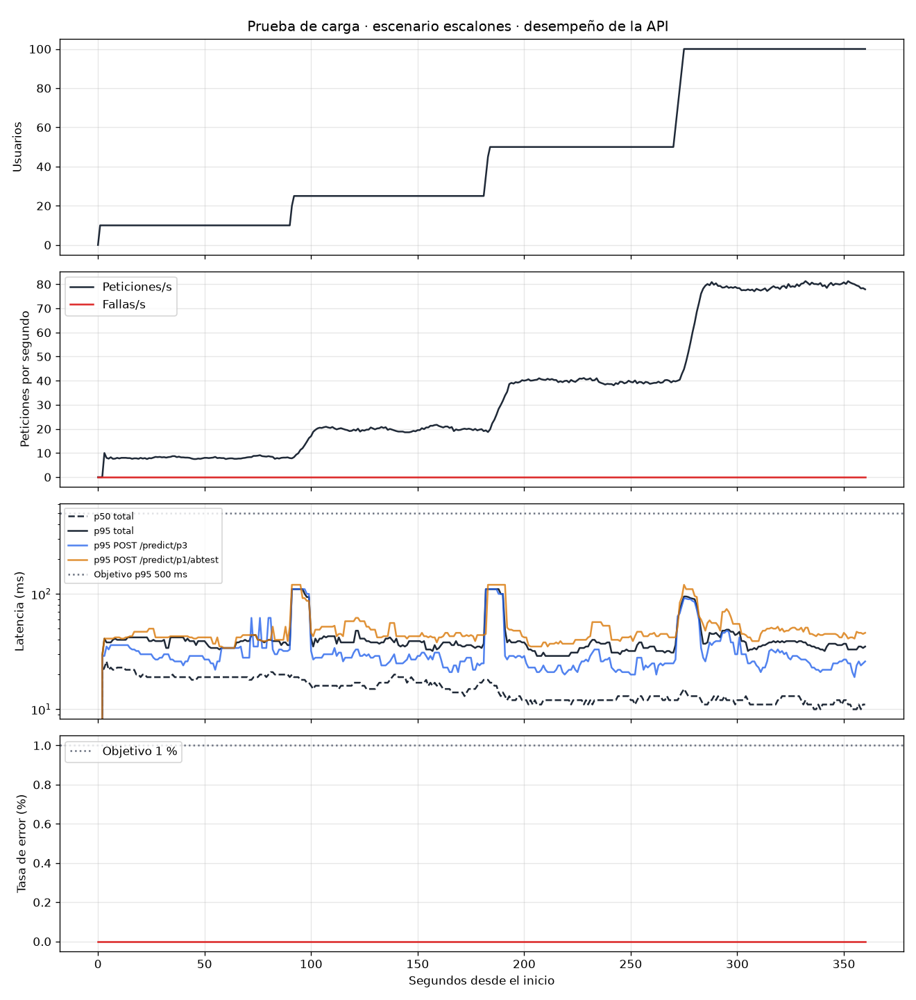 | 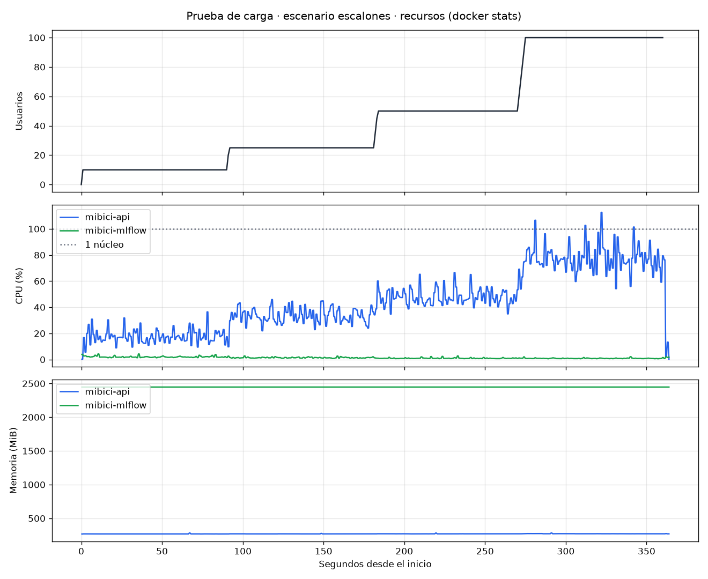 |
| Estrés | 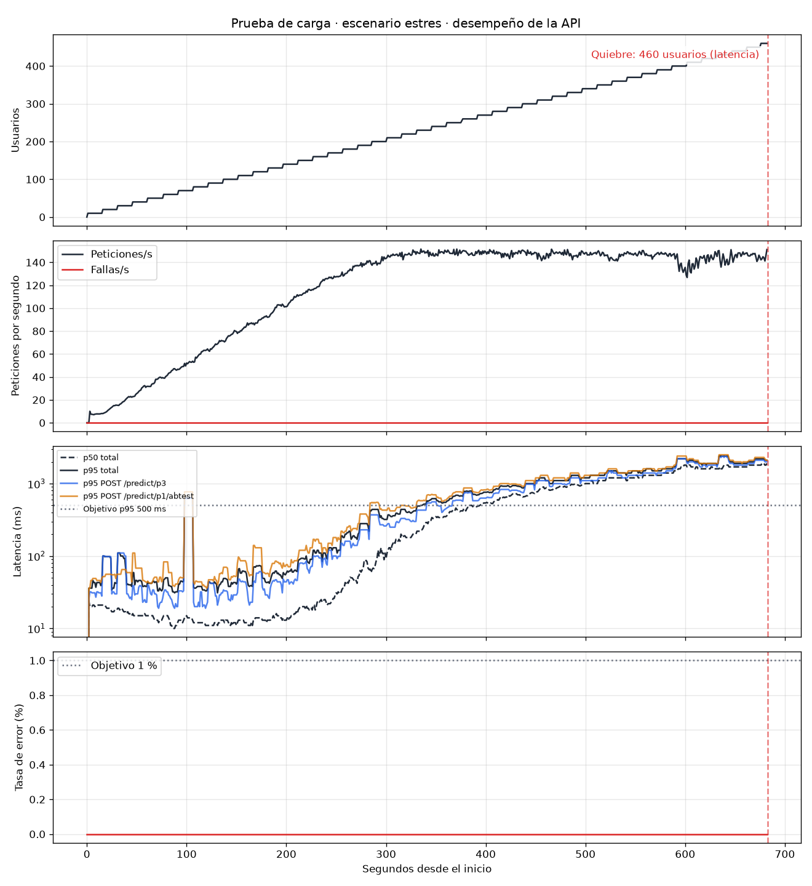 | 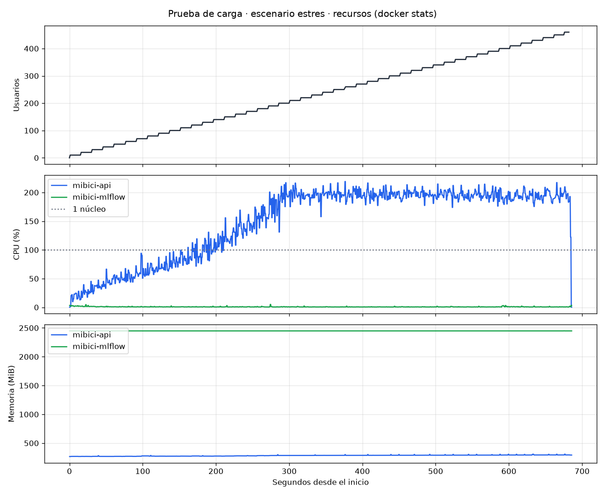 |

Reportes interactivos de Locust: [`escalones_locust.html`](reports/load/escalones_locust.html) y
[`estres_locust.html`](reports/load/estres_locust.html).

**Evidencia de la ejecución**

| Paso | Captura |
|---|---|
| Escenario incremental en la Terminal | 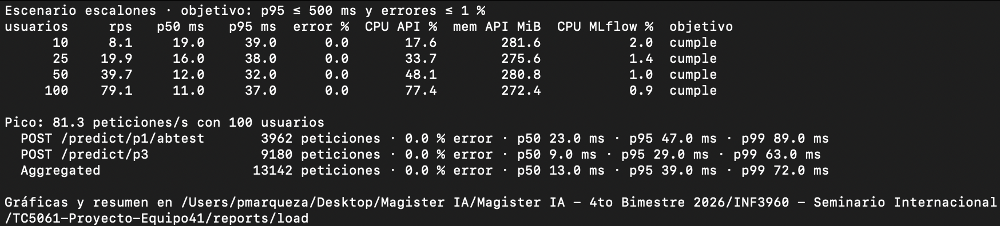 |
| Escenario de estrés y punto de quiebre | 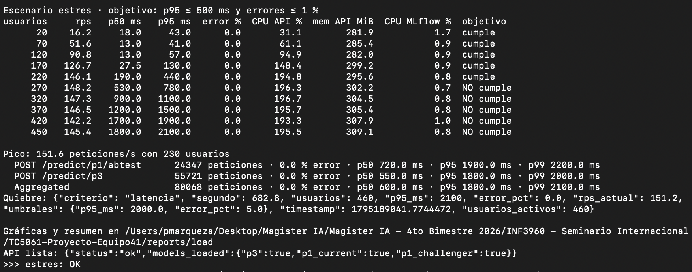 |
| `docker stats` durante la carga | 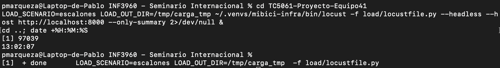 |
<!-- resultados-carga:fin -->

## P3. Agrupamiento de estaciones por patrones de uso

### Pregunta de negocio

¿Qué grupos de estaciones comparten patrones de uso y dónde se ubican en la ciudad?

### Objetivo

Identificar grupos de estaciones de MiBici con características de uso similares mediante un modelo de clustering. Los resultados pueden servir como apoyo para analizar la distribución de la demanda y explorar oportunidades de expansión del sistema.

### Datos y características

El análisis utiliza datos de viajes de MiBici y la información de nomenclatura de estaciones. Se construye un conjunto de características agregadas por estación, que incluye:

- Número de viajes de salida y llegada.
- Viajes de salida por franja horaria.
- Viajes de salida durante los fines de semana.
- Duración promedio de los viajes.
- Nombre y coordenadas geográficas de las estaciones.

Las variables numéricas utilizadas por el modelo se escalan antes de aplicar el algoritmo de clustering.

### Modelo y evaluación

Se utiliza K-Means para agrupar las estaciones. Se evalúan diferentes valores de K mediante el coeficiente de silueta (_*silhouette score*_), con el objetivo de comparar la separación y cohesión de los grupos.

El entrenamiento registra parámetros, métricas, etiquetas y artefactos en MLflow para facilitar la reproducibilidad y comparación de experimentos.

### Ejecución de P3

Desde la raíz del repositorio, ejecuta:

```bash
python -m mibici.modeling.p3.train
```

Para generar las asignaciones de grupos:

```bash
python -m mibici.modeling.p3.predict
```

Para generar el mapa de estaciones:

```bash
python -m mibici.modeling.p3.plot_clusters
```

### Resultados generados

- `models/p3_kmeans.pkl`: modelo entrenado.
- `data/processed/p3_station_features.csv`: características agregadas por estación.
- `data/processed/p3_station_clusters.csv`: asignación de las estaciones a sus grupos.
- `reports/figures/p3_clusters.png`: gráfica de evaluación del clustering.
- `reports/figures/p3_station_map.png`: mapa geográfico de las estaciones agrupadas.

### Interpretación

Los grupos permiten distinguir estaciones con diferentes niveles de actividad. La interpretación geográfica debe realizarse con el mapa y las características de cada grupo; no se debe asumir que los clústeres representan zonas geográficas claramente separadas sin evidencia adicional.

### Seguimiento de experimentos

Los experimentos de P3 se registran en MLflow bajo el experimento `mibici-p3-clustering`. Se guardan parámetros, métricas, etiquetas y artefactos para documentar y comparar las ejecuciones.

### Resultados e interpretación de los clústeres

El modelo K-Means seleccionó dos clústeres como resultado de la evaluación mediante el coeficiente de silueta. El conjunto analizado contiene 471 estaciones: 278 pertenecen al clúster 0 y 193 al clúster 1.

El clúster 0 presenta un promedio de 5,080.12 viajes de salida y 5,074.35 viajes de llegada por estación. En contraste, el clúster 1 registra 1,109.37 viajes de salida y 1,117.68 viajes de llegada por estación.

La duración promedio de los viajes es similar en ambos grupos: 10.94 minutos en el clúster 0 y 11.04 minutos en el clúster 1. Estos resultados sugieren que la principal diferencia entre los grupos está relacionada con el volumen de uso de las estaciones.

Para apoyar la interpretación espacial, se utiliza el mapa de estaciones agrupadas. La ubicación geográfica debe analizarse junto con los patrones de uso, sin asumir que cada clúster corresponde a una zona geográfica claramente delimitada.

Estos resultados pueden servir como punto de partida para estudiar la distribución de la demanda y detectar estaciones que podrían requerir análisis adicional para la planeación del sistema.
