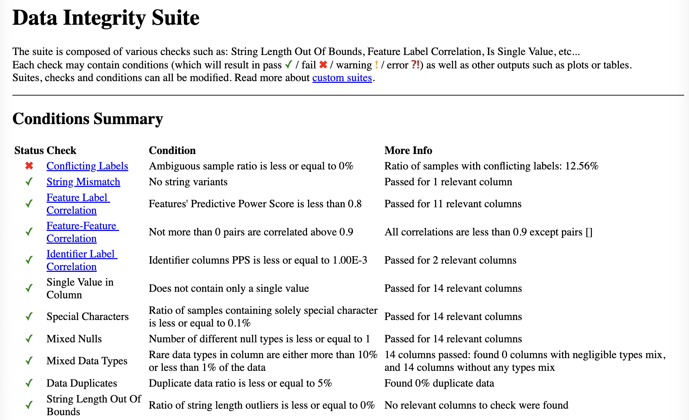
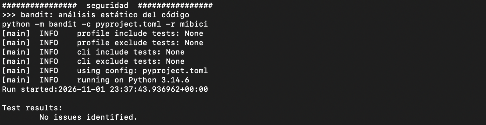
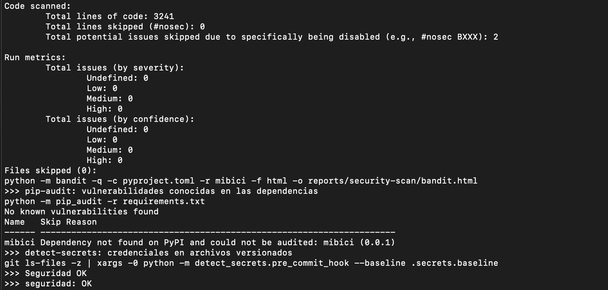
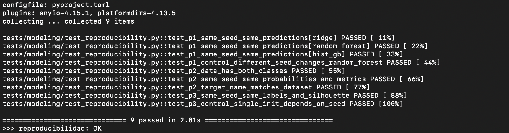
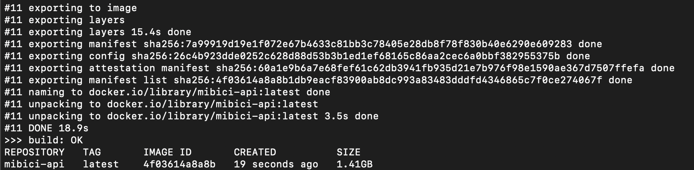
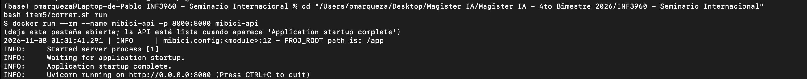
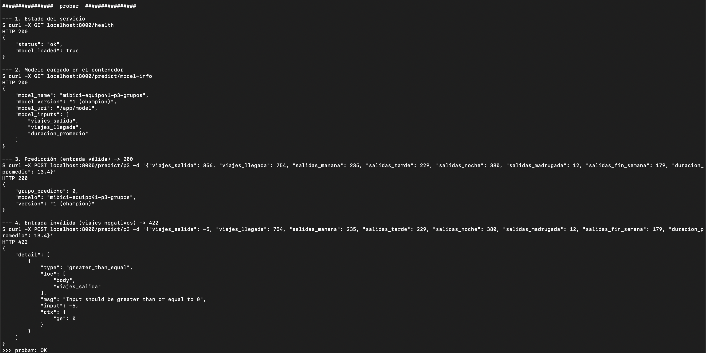

# MiBici

<a target="_blank" href="https://cookiecutter-data-science.drivendata.org/">
    
</a>

Dar respuesta a preguntas de negocio con técnicas de Machine Learning y DevOps sobre la operación de MiBici, el sistema de bicicleta pública del Área Metropolitana de Guadalajara. Para esto, se considera data histórica y de clustering para responder lo siguiente:

- P1: ¿Cuántos viajes se iniciarán en una estación o zona en un periodo futuro?.
- P2: ¿Una estación estará en riesgo de quedarse sin bicicletas o sin anclajes disponibles en un periodo futuro?
- P3: ¿Qué grupos de estaciones comparten patrones de uso y dónde se ubican en la ciudad?

## Organización del Proyecto

```
├── LICENSE            <- Open-source license if one is chosen
├── Makefile           <- Makefile with convenience commands like `make data` or `make train`
├── README.md          <- The top-level README for developers using this project.
├── data
│   ├── external       <- Data from third party sources.
│   ├── interim        <- Intermediate data that has been transformed.
│   ├── processed      <- The final, canonical data sets for modeling.
│   └── raw            <- The original, immutable data dump.
│
├── docs               <- A default mkdocs project; see www.mkdocs.org for details
│
├── models             <- Trained and serialized models, model predictions, or model summaries
│
├── notebooks          <- Jupyter notebooks. Naming convention is a number (for ordering),
│                         the creator's initials, and a short `-` delimited description, e.g.
│                         `1.0-jqp-initial-data-exploration`.
│
├── pyproject.toml     <- Project configuration file with package metadata for
│                         mibici and configuration for tools like black
│
├── references         <- Data dictionaries, manuals, and all other explanatory materials.
│
├── reports            <- Generated analysis as HTML, PDF, LaTeX, etc.
│   └── figures        <- Generated graphics and figures to be used in reporting
│
├── requirements.txt   <- The requirements file for reproducing the analysis environment, e.g.
│                         generated with `pip freeze > requirements.txt`
│
├── setup.cfg          <- Configuration file for flake8
│
└── mibici   <- Source code for use in this project.
    │
    ├── __init__.py             <- Makes mibici a Python module
    │
    ├── config.py               <- Store useful variables and configuration
    │
    ├── dataset.py              <- Scripts to download or generate data
    │
    ├── features.py             <- Code to create features for modeling
    │
    ├── modeling
    │   ├── __init__.py
    │   ├── predict.py          <- Code to run model inference with trained models
    │   └── train.py            <- Code to train models
    │
    └── plots.py                <- Code to create visualizations
```

---

### Setup inicial (Python 3.14)

El proyecto requiere **Python 3.14** (`pyproject.toml`). `requirements.txt` y `python_env.yaml`
fijan exactamente las mismas versiones.

```bash
python -m venv .venv
source .venv/bin/activate            # Windows: .venv\Scripts\activate
python -m pip install -r requirements.txt
```

---

### Servidor de tracking y variable `MLFLOW_TRACKING_URI`

El Model Registry requiere un backend con base de datos. En una terminal aparte (deja el
servidor corriendo):

```bash
mlflow server --backend-store-uri sqlite:///mlflow.db --port 5000
```

En la terminal de trabajo apunta MLflow al servidor:

```bash
export MLFLOW_TRACKING_URI=http://127.0.0.1:5000          # macOS / Linux
$env:MLFLOW_TRACKING_URI = "http://127.0.0.1:5000"        # Windows PowerShell
```

También puede ir en `.env` (`MLFLOW_TRACKING_URI="http://127.0.0.1:5000"`); `config.py` acepta
el nombre anterior `MLFLOW_URI` por compatibilidad. `mlflow.db` y `mlartifacts/` están en
`.gitignore`.

---

### Reproducir desde un clon limpio con `mlflow run`

1. Descarga los 12 CSV mensuales (`datos_abiertos_2025_10.csv` … `datos_abiertos_2026_09.csv`) y
   `nomenclatura_2026_09.csv` de https://mibici.net/es/datos-abiertos/ en `data/raw/`
   (los nombres están en `mibici/config.py`).
2. Con el servidor levantado y `MLFLOW_TRACKING_URI` exportada:

```bash
# Ingesta: limpia y une los datos, guarda el Parquet y escribe data/manifest.json
mlflow run . -e ingest --env-manager uv --experiment-name mibici-equipo41

# Entrenamiento por pregunta (o question=all para las tres)
mlflow run . -e train --env-manager uv --experiment-name mibici-equipo41 -P question=p1
mlflow run . -e train --env-manager uv --experiment-name mibici-equipo41 -P question=p2
mlflow run . -e train --env-manager uv --experiment-name mibici-equipo41 -P question=p3

# Con hiperparámetros (los defaults están en config.TRAIN_DEFAULTS)
mlflow run . -e train --env-manager uv --experiment-name mibici-equipo41 \
    -P question=p3 -P params="min_k=3,max_k=6"
```

- `--env-manager uv` crea el entorno de `python_env.yaml` (instala Python 3.14 si hace falta;
  requiere [uv](https://docs.astral.sh/uv/)). Si ya activaste `.venv` con `requirements.txt`,
  usa `--env-manager local` para reutilizarlo.
- Siempre pasa `--experiment-name mibici-equipo41`: el despachador rechaza corridas en otro
  experimento.
- Sin MLflow Project también funciona: `python -m mibici.dataset` y
  `python -m mibici.modeling.train --question p1`.

| Punto de entrada | Parámetros (`-P`)                                                                    | Qué hace                                                               |
| ---------------- | ------------------------------------------------------------------------------------ | ---------------------------------------------------------------------- |
| `ingest`         | —                                                                                    | `mibici/dataset.py`: Parquet en `data/interim/` y `data/manifest.json` |
| `train`          | `question` (p1, p2, p3, all), `model`, `params` (`"clave=valor,…"`), `stage_of_work` | `mibici/modeling/train.py` llama a `train_pX_model(...)`               |

### Versión de datos: `data/manifest.json`

La ingesta escribe, por archivo crudo, nombre, tamaño, codificación, número de filas, rango de
fechas (`date_min`, `date_max`) y SHA-256, además del hash del Parquet intermedio. `data_version`
(p. ej. `v1.0-b21c9761944d`) es un hash de los archivos crudos, del rango de fechas y de
`DATA_PIPELINE_VERSION`: si cambian los datos, cambia la versión. El manifiesto es el único
archivo de `data/` que se versiona en Git y se registra como artefacto en cada corrida.

### Trazabilidad común en MLflow (`mibici/modeling/tracking.py`)

| Función                                                  | Qué registra                                                                                         |
| -------------------------------------------------------- | ---------------------------------------------------------------------------------------------------- |
| `set_common_tags(question, model_family, stage_of_work)` | Etiquetas `team`, `git_commit`, `git_dirty`, `question`, `model_family`, `stage_of_work`             |
| `log_data_version(dataset=...)`                          | `data/manifest.json`, etiqueta `data_version` y el dataset con `mlflow.log_input`                    |
| `log_run_config(dict)`                                   | `config/run_config.json` y copia de `MLproject`, `python_env.yaml`, `requirements.txt` y `config.py` |

El despachador (`mibici/modeling/train.py`) crea una corrida `dispatch-…`, llama a
`train_pX_model(original_data, data_version, date_range, model=None, params=None)` y aplica estas
tres funciones a las corridas que la pregunta haya creado (quedan como corridas hijas). Cada
integrante puede llamarlas también dentro de sus propias corridas, por ejemplo para fijar
`stage_of_work="baseline"`.

Revisa los resultados en http://127.0.0.1:5000 (experimento `mibici-equipo41`).

---

### Como cargar el dataset inicial para uso en notebooks

1. Descarga los datos de nomenclatura y viajes mensuales https://mibici.net/es/datos-abiertos/
2. Revisa las declaraciones de `config.py`, modifica a partir de los datos que necesites

```

DATA_METADATA = {
    'monthly': YEARLY_DATA,
    'stations': STATIONS_DATA,
    'data_range': {'from': '2025_09', 'to': '2026_09'}
}
```

3. Ejecuta `dataset.py` para que se generen los datos procesados en `/data/interim`, observa los ejemplos propuestos en `dataset.py` y ajusta de ser necesario.

## Pruebas, validación de datos y seguridad

Todo se ejecuta desde la raíz del repositorio con el entorno del proyecto activado (Python 3.14,
`pip install -r requirements.txt`). Las pruebas no usan los datos reales ni el servidor de
MLflow: trabajan con datos sintéticos y un tracking temporal (`tests/conftest.py`).

| Comando | Qué hace | Requiere |
|---|---|---|
| `make test` | PyTest: pruebas unitarias, reproducibilidad del entrenamiento e higiene del repo | Entorno del proyecto |
| `make security` | bandit (código), pip-audit (dependencias) y detect-secrets (credenciales) | Entorno del proyecto + internet (pip-audit) |
| `make validation-env` | Crea el entorno de validación (Python 3.12) en `~/.venvs/mibici-validation` | [uv](https://docs.astral.sh/uv/), una sola vez |
| `make validate` | DeepChecks sobre los datos de P1, P2 y P3; reportes en `reports/validation/` | Datos en `data/raw/` + entorno de validación |
| `make check` | Los tres anteriores en orden | Todo lo anterior |

Sin `make`: `python -m pytest`; los comandos de seguridad y validación están en el `Makefile`.

### Pruebas (PyTest)

```
tests/
├── conftest.py                      # datos sintéticos y MLflow temporal
├── mibici/test_dataset.py           # ingesta, manifiesto, hash y data_version
├── mibici/test_features.py          # limpieza y variables comunes
├── modeling/test_reproducibility.py # reproducibilidad de P1, P2 y P3
└── test_repo_hygiene.py             # seguridad del repositorio como pruebas
```

- **Unitarias**: casos normales y límite de la ingesta (`clean_trips`, `join_station_metadata`,
  `build_manifest`, `compute_data_version`…) y de `features.py` (fechas inválidas, duraciones
  negativas, duplicados y nulos).
- **Reproducibilidad**: cada pregunta entrena dos veces con la misma semilla y exige
  resultados idénticos — predicciones de Ridge, Random Forest y HistGradientBoosting (P1),
  probabilidades y métricas de la regresión logística (P2), etiquetas y silhouette de K-Means
  (P3). Dos pruebas de control cambian la semilla y verifican que la diferencia sí se detecta.
- **Higiene del repositorio**: rutas sensibles cubiertas por `.gitignore`, ningún archivo de
  datos, MLflow, modelos o credenciales versionado hoy **ni en el historial**, `.env.example`
  sin secretos y detect-secrets sin hallazgos nuevos.

### Validación de datos (DeepChecks)

`mibici/validation/validate_p3_data.py` ejecuta la suite de integridad de DeepChecks (tipos
mezclados, nulos, duplicados, valores únicos, caracteres especiales, etiquetas en conflicto,
correlaciones) sobre la tabla de P1, la tabla estación-hora de P2 y las características de
estaciones de P3.

DeepChecks 0.19.1, su última versión, no es compatible con el stack del proyecto: importa
`pkg_resources` (ya no incluido en setuptools ≥ 81), usa `np.Inf` (eliminado en numpy 2) y pide
el scorer `max_error` (eliminado en scikit-learn 1.9). Por eso corre en un **entorno aparte**
con Python 3.12 y versiones fijas en `requirements-validation.txt`. `make validate`:

1. En el entorno del proyecto, `python -m mibici.validation.prepare_inputs` deja listo el
   dataset común (`data/interim/`) y `data/processed/p3_station_features.csv`.
2. En el entorno de validación corre `validate_p3_data.py`, que lee esos archivos y escribe
   los reportes HTML.

```bash
make validation-env    # una sola vez
make validate
```

### Seguridad

| Chequeo | Herramienta | Resultado |
|---|---|---|
| Código | `bandit -c pyproject.toml -r mibici` | Sin hallazgos. Los 11 avisos previos (llamadas a `git` con `subprocess` en tres copias de la misma función) se corrigieron: una sola función en `tracking.py`, con ruta absoluta a `git` y argumentos fijos; las 2 supresiones `# nosec` restantes están justificadas en el código. |
| Dependencias | `pip-audit -r requirements.txt` | Sin vulnerabilidades. Se encontró **CVE-2026-53995** (path traversal en FileStore) en mlflow 3.17.0 y se actualizó a 3.17.2. |
| Dependencias de validación | `pip-audit` sobre `~/.venvs/mibici-validation` | 3 avisos en setuptools 80.9.0 (construcción de sdist y wheels legacy en Windows). **Riesgo aceptado**: DeepChecks necesita `pkg_resources`, que no existe en las versiones corregidas, y el entorno de validación no construye ni instala paquetes de terceros. |
| Credenciales | `detect-secrets` con `.secrets.baseline` | Sin secretos. La línea base excluye por regla los falsos positivos: hashes SHA-256 del manifiesto, imágenes PNG embebidas en notebooks y reportes HTML de DeepChecks. |
| Datos y variables de entorno | `.gitignore` + `.env.example` + `tests/test_repo_hygiene.py` | Datos de MiBici, `mlflow.db`, `mlartifacts/`, modelos y `.env` ignorados; ninguno aparece en el historial. Las variables locales van en `.env` (copiar desde `.env.example`). |

### Evidencia

| Ejecución | Captura |
|---|---|
| PyTest |  |
| DeepChecks |  |
| bandit |  |
| pip-audit y detect-secrets |  |
| Reproducibilidad |  |

Reportes generados: `reports/security-scan/bandit.html` y `reports/validation/*.html`.

## Correr FastAPI con Docker

La API sirve el modelo de **P3** (grupos de estaciones). El modelo se toma del Model Registry de
MLflow por nombre y alias (`mibici-equipo41-p3-grupos@champion`) y **se empaqueta en la imagen**:
`export_model.py` descarga del registry la versión que tiene el alias (`MLmodel`, `model.skops`,
firma de entrada) a `models/p3_model/` y anota su número en `models/p3_model/VERSION`. Así el
contenedor no necesita un servidor de MLflow para arrancar, y la imagen queda atada a una versión
concreta del modelo.

**Precondición**: el modelo de P3 debe estar entrenado y registrado. Si no lo está:
`mlflow run . -e train --env-manager local --experiment-name mibici-equipo41 -P question=p3`.

**Pasos** (desde la raíz del repositorio, con Docker Desktop abierto):

1. Levanta MLflow: `mlflow server --backend-store-uri sqlite:///mlflow.db --port 5000`
2. En otra terminal, descarga el modelo campeón del registry:
   ```bash
   export MLFLOW_TRACKING_URI=http://127.0.0.1:5000
   python -m mibici.api.scripts.export_model
   ```
3. Construye la imagen: `docker build -t mibici-api .`
4. Levanta el contenedor: `docker run --rm --name mibici-api -p 8000:8000 mibici-api`
5. Prueba la API desde otra terminal (o en `http://localhost:8000/docs`):

| Endpoint | Qué devuelve |
|---|---|
| `GET /health` | Estado del servicio y si el modelo quedó cargado |
| `GET /predict/model-info` | Nombre, versión y alias del modelo, y las columnas de su firma |
| `POST /predict/p3` | Grupo predicho para una estación |

**Entrada.** La petición trae el uso agregado de una estación, con el mismo esquema que
`data/processed/p3_station_features.csv`. La API calcula las variables del modelo
(proporciones por franja horaria y logaritmos de los viajes) con la misma función del
entrenamiento (`prepare_features`) y entrega al modelo solo las columnas de su firma, sea cual sea
el candidato que quedó como campeón.

```bash
curl -X POST http://localhost:8000/predict/p3 \
  -H "Content-Type: application/json" \
  -d '{"viajes_salida": 856, "viajes_llegada": 754, "salidas_manana": 235,
       "salidas_tarde": 229, "salidas_noche": 380, "salidas_madrugada": 12,
       "salidas_fin_semana": 179, "duracion_promedio": 13.4}'
```

```json
{"grupo_predicho": 0, "modelo": "mibici-equipo41-p3-grupos", "version": "1 (champion)"}
```

El número de grupo y la versión dependen del modelo registrado en cada equipo.

**Validación (Pydantic).** Todos los campos son obligatorios; los conteos son enteros ≥ 0; la
duración, en minutos, está entre 0 y 1440; la suma de salidas por franja y las salidas de fin de
semana no pueden superar `viajes_salida`; no se aceptan campos extra. Una entrada inválida
responde `422` con el campo y el motivo, por ejemplo:

```json
{"detail": [{"type": "greater_than_equal", "loc": ["body", "viajes_salida"],
             "msg": "Input should be greater than or equal to 0", "input": -5, "ctx": {"ge": 0}}]}
```

### Evidencia del contenedor

| Paso | Captura |
|---|---|
| `docker build` |  |
| `docker run` |  |
| Peticiones a la API |  |

## P3. Agrupamiento de estaciones por patrones de uso

### Pregunta de negocio

¿Qué grupos de estaciones comparten patrones de uso y dónde se ubican en la ciudad?

### Objetivo

Identificar grupos de estaciones de MiBici con características de uso similares mediante un modelo de clustering. Los resultados pueden servir como apoyo para analizar la distribución de la demanda y explorar oportunidades de expansión del sistema.

### Datos y características

El análisis utiliza datos de viajes de MiBici y la información de nomenclatura de estaciones. Se construye un conjunto de características agregadas por estación, que incluye:

- Número de viajes de salida y llegada.
- Viajes de salida por franja horaria.
- Viajes de salida durante los fines de semana.
- Duración promedio de los viajes.
- Nombre y coordenadas geográficas de las estaciones.

Las variables numéricas utilizadas por el modelo se escalan antes de aplicar el algoritmo de clustering.

### Modelo y evaluación

Se utiliza K-Means para agrupar las estaciones. Se evalúan diferentes valores de K mediante el coeficiente de silueta (_silhouette score_), con el objetivo de comparar la separación y cohesión de los grupos.

El entrenamiento registra parámetros, métricas, etiquetas y artefactos en MLflow para facilitar la reproducibilidad y comparación de experimentos.

### Ejecución de P3

Desde la raíz del repositorio, ejecuta:

```bash
python -m mibici.modeling.p3.train
```

Para generar las asignaciones de grupos:

```bash
python -m mibici.modeling.p3.predict
```

Para generar el mapa de estaciones:

```bash
python -m mibici.modeling.p3.plot_clusters
```

### Resultados generados

- `models/p3_kmeans.pkl`: modelo entrenado.
- `data/processed/p3_station_features.csv`: características agregadas por estación.
- `data/processed/p3_station_clusters.csv`: asignación de las estaciones a sus grupos.
- `reports/figures/p3_clusters.png`: gráfica de evaluación del clustering.
- `reports/figures/p3_station_map.png`: mapa geográfico de las estaciones agrupadas.

### Interpretación

Los grupos permiten distinguir estaciones con diferentes niveles de actividad. La interpretación geográfica debe realizarse con el mapa y las características de cada grupo; no se debe asumir que los clústeres representan zonas geográficas claramente separadas sin evidencia adicional.

### Seguimiento de experimentos

Los experimentos de P3 se registran en MLflow bajo el experimento `mibici-p3-clustering`. Se guardan parámetros, métricas, etiquetas y artefactos para documentar y comparar las ejecuciones.

### Resultados e interpretación de los clústeres

El modelo K-Means seleccionó dos clústeres como resultado de la evaluación mediante el coeficiente de silueta. El conjunto analizado contiene 471 estaciones: 278 pertenecen al clúster 0 y 193 al clúster 1.

El clúster 0 presenta un promedio de 5,080.12 viajes de salida y 5,074.35 viajes de llegada por estación. En contraste, el clúster 1 registra 1,109.37 viajes de salida y 1,117.68 viajes de llegada por estación.

La duración promedio de los viajes es similar en ambos grupos: 10.94 minutos en el clúster 0 y 11.04 minutos en el clúster 1. Estos resultados sugieren que la principal diferencia entre los grupos está relacionada con el volumen de uso de las estaciones.

Para apoyar la interpretación espacial, se utiliza el mapa de estaciones agrupadas. La ubicación geográfica debe analizarse junto con los patrones de uso, sin asumir que cada clúster corresponde a una zona geográfica claramente delimitada.

Estos resultados pueden servir como punto de partida para estudiar la distribución de la demanda y detectar estaciones que podrían requerir análisis adicional para la planeación del sistema.
